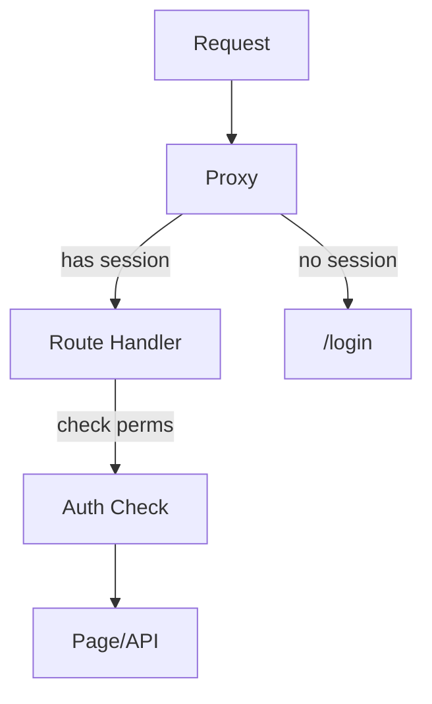

# Authentication System

The application uses session-based authentication with proxy protection.

## Overview



---

## Session Management

Sessions are stored server-side with JWT tokens for validation.

Users manage their own account details from the `Profile` settings tab:
- Update display name
- Change password by confirming the current password
- View their current email and role

Admins manage other accounts from the `Users` settings tab:
- Create users
- Edit display name, email, and role
- Delete users
- Initiate password reset links for existing users

### Protected Routes
The proxy (`src/proxy.ts`) protects:
- All routes except `/login`, `/register`, `/api/auth/*`
- Static assets are excluded

### Public Routes
- `/login` - User login
- `/forgot-password` - Password reset request flow
- `/reset-password` - Password reset completion flow
- `/register` - User registration  
- `/api/auth/*` - Auth API endpoints

---

## User Roles

| Role | Permissions |
|------|-------------|
| `admin` | Full access, manage users and settings |
| `member` | Create/edit own dashboards |
| `viewer` | View shared dashboards only |

---

## Access Control

### Dashboard Access
Each dashboard has an `accessLevel`:

| Level | View | Edit |
|-------|------|------|
| `PUBLIC` | Everyone | Everyone |
| `VIEWABLE` | Everyone | Owner only |
| `PRIVATE` | Owner only | Owner only |

### Object Permissions
Override base access per-user via `ObjectPermission`:

| Permission | Effect |
|------------|--------|
| `BLOCKED` | Deny all access |
| `VIEW` | Allow viewing |
| `EDIT` | Allow full access |

---

## API Authentication

API routes check authentication via:

```typescript
// In API route
const session = await getServerSession();
if (!session) {
  return NextResponse.json({ error: 'Unauthorized' }, { status: 401 });
}
```

---

## Proxy Flow

```typescript
// src/proxy.ts
export function proxy(request: NextRequest) {
  const session = request.cookies.get('session');
  
  if (!session && !isPublicRoute(request.pathname)) {
    return NextResponse.redirect('/login');
  }
  
  return NextResponse.next();
}
```

---

## Security Features

- Password hashing with bcrypt
- Self-service password changes require the current password
- Password reset links are one-time tokens stored server-side with expiration
- Password changes and completed resets revoke every previously issued session
- Forgot-password requests are throttled by hashed email and client IP
- Admin password help uses reset links instead of exposing a user's password
- HTTP-only session cookies
- CSRF protection on forms
- API keys encrypted in database
- Integration credentials never exposed to client

## Password Reset Delivery

Password resets support two operating modes:

- Automated delivery: configure `PASSWORD_RESET_WEBHOOK_URL` to hand the reset link to your own email/automation system
- Admin-assisted delivery: if no webhook is configured, users are instructed to contact an admin and admins can generate a manual reset link from settings

Production reset links require a canonical application origin. Configure `NEXTAUTH_URL`
to the externally reachable HTTPS origin; request forwarding headers are never trusted
to construct credential links.

Environment variables:

- `NEXTAUTH_URL` - Canonical public origin used in reset links; required when creating production reset links
- `PASSWORD_RESET_WEBHOOK_URL` - Receives JSON payloads with the reset link
- `PASSWORD_RESET_WEBHOOK_SECRET` - Sent as a bearer token to the webhook
- `ADMIN_CONTACT_EMAIL` - Shown to users when resets are admin-assisted

The public reset-request endpoint allows three requests per email and ten requests per
client IP during each 15-minute window. Keys are SHA-256 hashed before storage. Multiple
unexpired links may coexist so a newer request cannot invalidate a previously delivered
link; completing any reset consumes all outstanding links for that user atomically.
