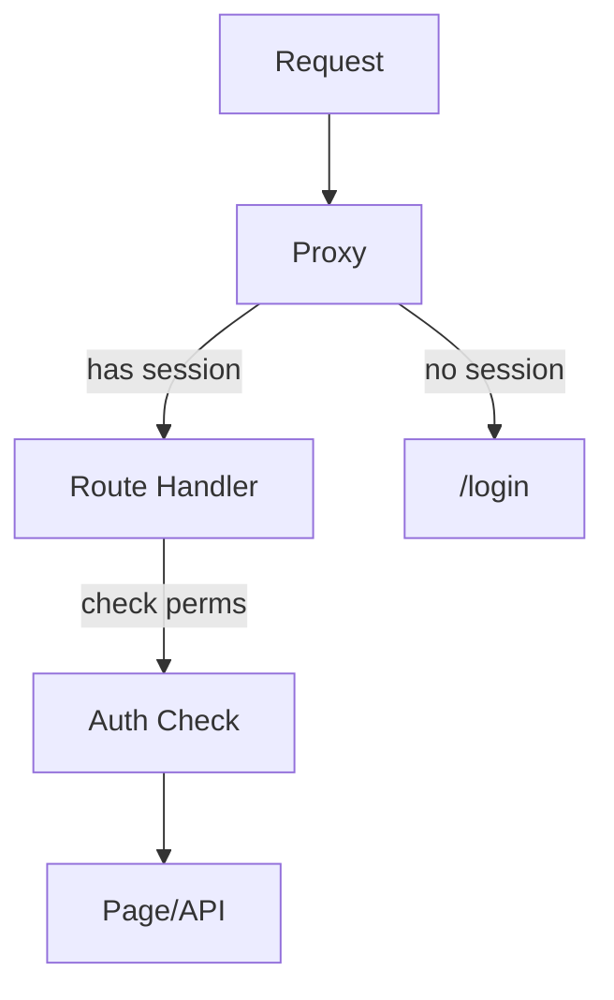

# Authentication System

The application uses session-based authentication with proxy protection.

## Overview



---

## Session Management

Sessions are stored server-side with JWT tokens for validation.

Users manage their own account details from the `Profile` settings tab:
- Update display name
- Change password by confirming the current password
- View their current email and role

Admins manage other accounts from the `Users` settings tab:
- Create users
- Edit display name, email, and role
- Delete users
- Initiate password reset links for existing users

### Protected Routes
The proxy (`src/proxy.ts`) protects:
- All application and API routes except the exact public routes below
- Only known static assets and safe methods are excluded

### Public Routes
- `/login` - User login
- `/setup` - Bootstrap-secret-protected initial setup
- `/reset-password` - Completion of an administrator-issued one-time reset
- `/api/setup` and `/api/setup/check` - Initial setup endpoints
- `/api/auth/reset-password` - One-time token consumption
- NextAuth's exact sign-in, sign-out, session, CSRF, and callback routes

---

## User Roles

| Role | Permissions |
|------|-------------|
| `admin` | Full access, manage users and settings |
| `member` | Create/edit own dashboards |
| `viewer` | View shared dashboards only |

---

## Access Control

### Dashboard Access
Each dashboard has an `accessLevel`:

| Level | View | Edit |
|-------|------|------|
| `PUBLIC` | Everyone | Everyone |
| `VIEWABLE` | Everyone | Owner only |
| `PRIVATE` | Owner only | Owner only |

### Object Permissions
Override base access per-user via `ObjectPermission`:

| Permission | Effect |
|------------|--------|
| `BLOCKED` | Deny all access |
| `VIEW` | Allow viewing |
| `EDIT` | Allow editing |

Ownership always takes precedence over overrides. Owners retain edit access even
if a legacy `BLOCKED` or `VIEW` override exists. Only object owners and
administrators may list, grant, or remove permission overrides; shared editors
cannot administer access. New overrides targeting an owner are rejected, while
owners and administrators may remove old ones.

A saved preferred dashboard is checked against current permissions on every load.
Blocking a user revokes access even if they previously selected that dashboard.

---

## API Authentication

API routes check authentication via:

```typescript
// In API route
const session = await getServerSession();
if (!session) {
  return NextResponse.json({ error: 'Unauthorized' }, { status: 401 });
}
```

---

## Proxy Flow

```typescript
// src/proxy.ts
export function proxy(request: NextRequest) {
  const session = request.cookies.get('session');
  
  if (!session && !isPublicRoute(request.pathname)) {
    return NextResponse.redirect('/login');
  }
  
  return NextResponse.next();
}
```

---

## Security Features

- Password hashing with bcrypt
- Self-service password changes require the current password
- Password reset links are one-time tokens stored server-side with expiration
- Password changes and completed resets revoke every previously issued session
- Only administrators can issue password reset links
- HTTP-only session cookies
- Exact public/static route allowlists and first-party request enforcement on mutations
- Live role and account-status checks on every session, with immediate revocation
- Bootstrap-secret protection for the one-time first-administrator claim
- API keys encrypted in database
- Integration credentials never exposed to client

## Password Recovery

Password recovery is administrator-assisted. An administrator creates a one-time link
from User Management and shares it directly with the user. The link expires after one
hour; completing it consumes every outstanding reset link for that user and revokes all
of their existing sessions. dotHome does not send reset links through email or webhooks.

The server returns a relative reset path and the administrator's browser constructs the
shareable URL from the page it is currently using. Request Host and forwarding headers
therefore do not influence reset links or mutation authorization.

Environment variables:

- `BOOTSTRAP_SECRET` - Optional explicit secret for the first-admin claim; otherwise a mode-0600 secret is persisted beside the SQLite database

`NEXTAUTH_URL` is not required for credentials authentication. A canonical public URL
should be introduced when OAuth/OIDC callbacks are added in the future.
